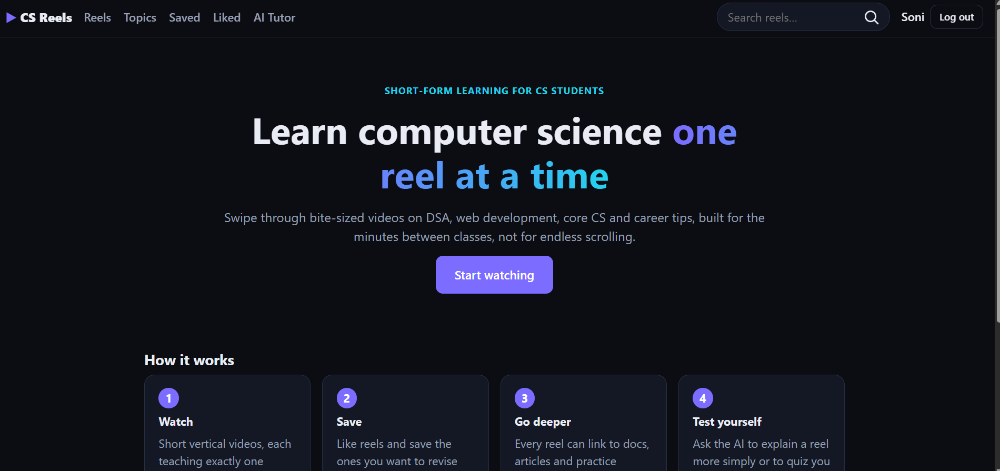
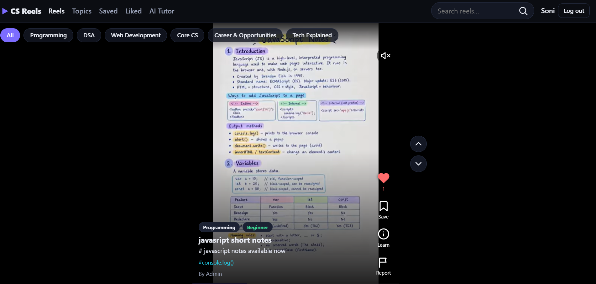
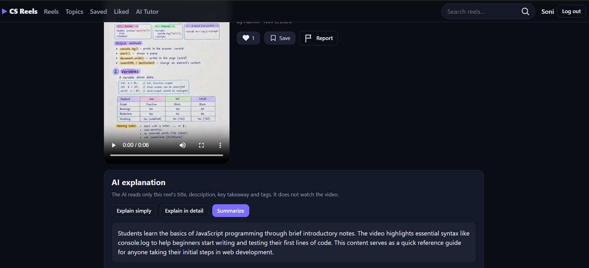
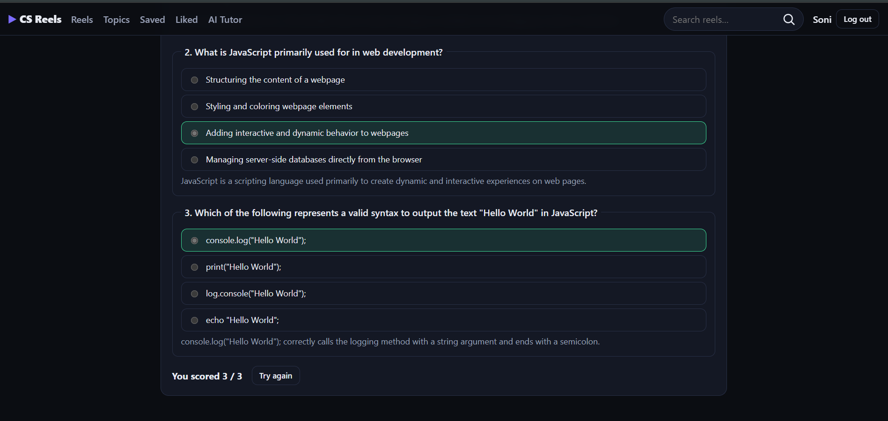
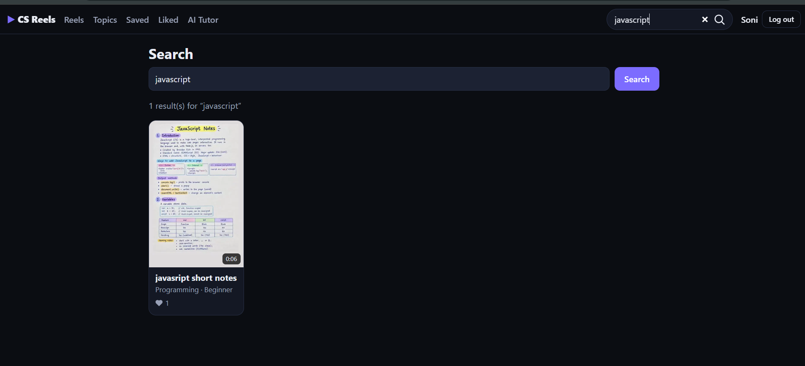
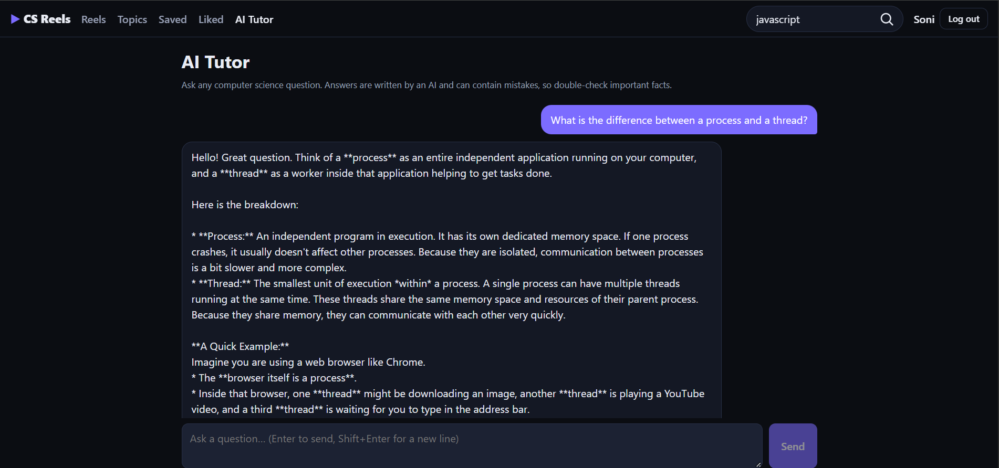
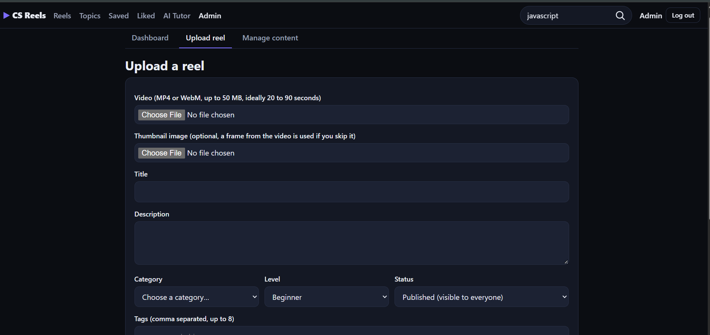
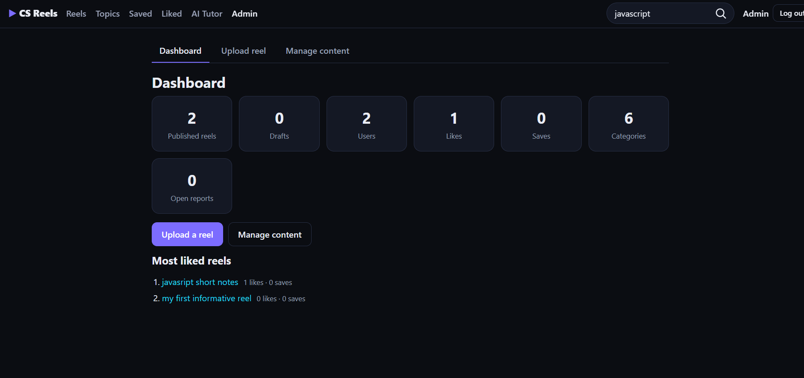
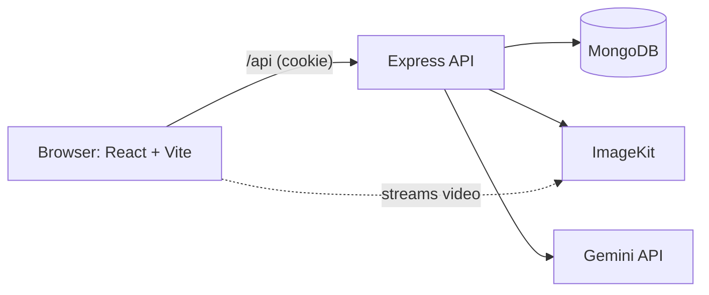

# CS Reels

**Built by Soni Singh and Sagar Chettri.**

**Short-form learning videos for computer science students.** Swipe through bite-sized videos on DSA, web development, core CS and career tips, then save them, test yourself with an AI quiz, or ask an AI tutor, all in one place.

| | |
|---|---|
| **Demo video** | https://youtu.be/jIJvZNRs0OM |
| **Source code** | https://github.com/sonisingh01/cs-reels |
| **Live link** | Not deployed for this prototype. It runs locally: see [Run it locally](#run-it-locally) |
| **Team** | Soni Singh and Sagar Chettri (both worked on the frontend and the backend, roughly 50-50) |

---

## The problem
Students lose study time to entertainment-first short-video apps, while long tutorials don't fit the minutes between classes. There is no focused place for quick, organised CS learning with a clear next step.

## The solution
CS Reels is a learning-only reels platform. Each reel teaches one idea, sits in a topic and a difficulty level, and can link to docs, articles and practice problems. Students can like and save reels for revision and use AI to understand a reel better.

## Screenshots
| Landing | Reels feed (mobile) |
|---|---|
|  |  |
| **Reel page with AI explanation** | **AI quiz** |
|  |  |
| **Search** | **AI tutor** |
|  |  |
| **Admin: upload a reel** | **Admin: dashboard** |
|  |  |

## Features

### Core (MVP)
- **Vertical reels feed:** one reel at a time, only the visible reel plays, swipe/scroll or arrow keys to move, play/pause, sound toggle, paginated loading, loading, empty and error states.
- **Guests can browse and watch;** login is needed to like, save, report or use AI.
- **Accounts:** register, login, logout; passwords hashed; session in an HTTP-only cookie.
- **Topics and levels:** browse by topic, filter by beginner / intermediate / advanced.
- **Search:** by title, description, tag or topic name (partial words work).
- **Likes and saves:** instant UI, accurate counts, no duplicates; Saved, Liked and Profile pages.
- **Related resources and key takeaway** on every reel; **related reels** suggested from shared tags and topic.
- **Report a reel;** admins review reports.
- **Admin dashboard:** statistics, upload video (MP4/WebM) with thumbnail, edit, publish/unpublish, delete, manage topics, review reports. Admin rights are enforced on the server.

### AI features (Google Gemini, called only from the backend)
- **Explain this reel** (simple or detailed) and **summary**
- **Quiz generator:** 3 to 5 multiple-choice questions, validated before display, stored and reused
- **AI tutor chat** for general CS questions

The AI receives only a reel's **text details** (title, description, key takeaway, tags). It does **not** watch the video, and the interface says so.

## Tech stack
| Layer | Technology |
|---|---|
| Frontend | React 19, Vite, React Router, Axios, plain CSS (dark, mobile-first) |
| Backend | Node.js, Express 5, REST API |
| Database | MongoDB with Mongoose |
| Auth and security | JWT in HTTP-only cookie, bcrypt hashing, zod validation, Helmet, CORS, rate limiting |
| Media | ImageKit (video and image storage and delivery) |
| AI | Google Gemini API (provider code isolated so it can be swapped) |
| Testing | Node test runner + Supertest (backend), Vitest + Testing Library (frontend) |

## Architecture

Request path: route, then middleware (rate limit, authentication, role check, validation), then controller, then service or model. All errors return one JSON shape.

## Project structure
```
cs-reels/
├── backend/
│   ├── server.js
│   ├── scripts/seed.js          creates topics + admin account
│   ├── src/ config/ models/ routes/ controllers/ middleware/ validators/ services/ utils/
│   └── tests/
├── frontend/
│   └── src/ pages/ components/ layouts/ context/ hooks/ services/ utils/ test/
└── docs/                        API, testing, deployment, evaluation guide
```

## Run it locally

**You need:** Node.js 20+ (built with 24), a MongoDB database (free [MongoDB Atlas](https://www.mongodb.com/atlas) cluster works), and optionally ImageKit and Gemini keys.

```bash
git clone https://github.com/sonisingh01/cs-reels.git
cd cs-reels

# 1. Backend
cd backend
npm install
cp .env.example .env        # Windows Command Prompt: copy .env.example .env
# edit .env (see the table below)
npm run seed                # creates the topics and your admin account
npm run dev                 # http://localhost:5000

# 2. Frontend (new terminal)
cd frontend
npm install
npm run dev                 # http://localhost:5173
```
Open http://localhost:5173 and log in with the `ADMIN_EMAIL` / `ADMIN_PASSWORD` from your `.env`. Use **Admin → Upload reel** to add content.

### Environment variables (`backend/.env`)
| Variable | Required | Purpose |
|---|---|---|
| `MONGODB_URI` | yes | MongoDB connection string (include a database name, e.g. `/csreels`) |
| `JWT_SECRET` | yes | 32+ random characters (`node -e "console.log(require('crypto').randomBytes(48).toString('hex'))"`) |
| `CLIENT_ORIGIN` | yes | `http://localhost:5173` for local use |
| `ADMIN_NAME`, `ADMIN_EMAIL`, `ADMIN_PASSWORD` | for seed | the admin account created by `npm run seed` |
| `IMAGEKIT_PRIVATE_KEY` | for uploads | ImageKit private key |
| `GEMINI_API_KEY`, `GEMINI_MODEL` | for AI | Gemini key and a model that is free for your project |

Without the ImageKit and Gemini keys the app still runs; uploads and AI features show a clear "not configured" message.

## Tests
```bash
cd backend && npm test      # 51 integration tests, real MongoDB, uses a separate "csreels_test" database
cd frontend && npm test     # 32 behaviour tests
```
Covered: authentication, role protection, validation, NoSQL-injection attempts, feed, search and pagination, likes and saves (including simultaneous requests), upload rules and failure cleanup, AI validation and caching, and the main screens and flows. ImageKit and Gemini are tested against mock servers; the real services need your keys.

## API
Full endpoint list: [`docs/API.md`](docs/API.md).

## Security highlights
Hashed passwords; HTTP-only cookies; server-side role checks on every admin route; validation on every request; escaped search input; uploads checked by type, size and file signature before storage; uploaded files removed if saving fails; rate limits on login, reports, AI and the API; secrets only in environment variables (`.env` is git-ignored).

## Limitations (prototype)
- AI sees only reel text, not the video (no transcription yet).
- A reel's video file cannot be replaced after upload (upload a new reel instead).
- Quiz scoring happens in the browser; chat history is not saved.
- Search is not relevance-ranked; recommendations are rule-based, not machine learning.

## Roadmap
Streaks and progress dashboard, creator profiles and playlists, transcript-based AI, email verification and password reset, comments, analytics.

## Acknowledgements and originality
- Built with open-source libraries: React, Vite, React Router, Axios, Express, Mongoose, zod, jsonwebtoken, bcryptjs, multer, helmet, express-rate-limit, Vitest, Supertest and others listed in the `package.json` files, each under its own license.
- Third-party services: MongoDB Atlas, ImageKit, Google Gemini API.
- We used an AI assistant (Claude by Anthropic) during development to help plan the project, took help whenever got stuck in code writing and debug code and documentation. We wrote most of the code, ran, tested and integrated the result ourselves.

## Demo content and credits
The reels in the demo are sample content used only to show the platform working. They are not presented as the team's own teaching work.
- One demo reel was recorded by a friend of the team.
- One demo reel is a screen recording of a video from the YouTube channel [@tech_edu.26](https://www.youtube.com/@tech_edu.26) ([original video](https://youtube.com/shorts/4suAlthPUTQ)). All rights belong to its creator. It is shown only to demonstrate the platform and will be removed on request.