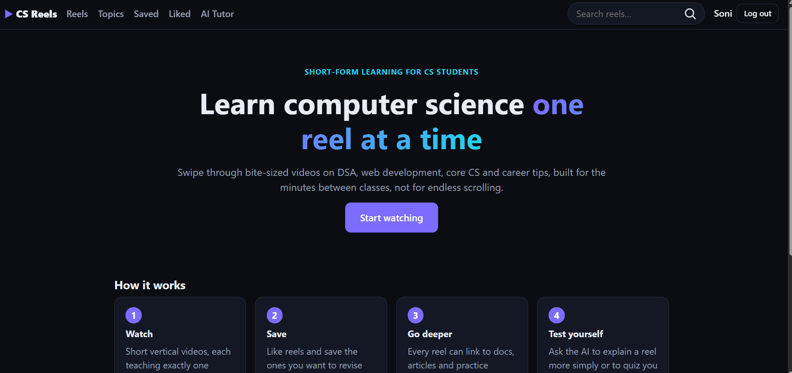
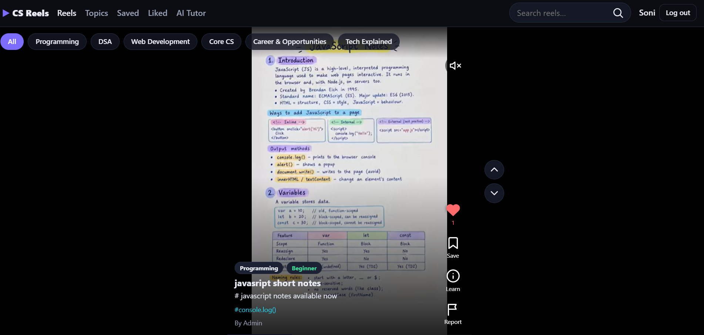
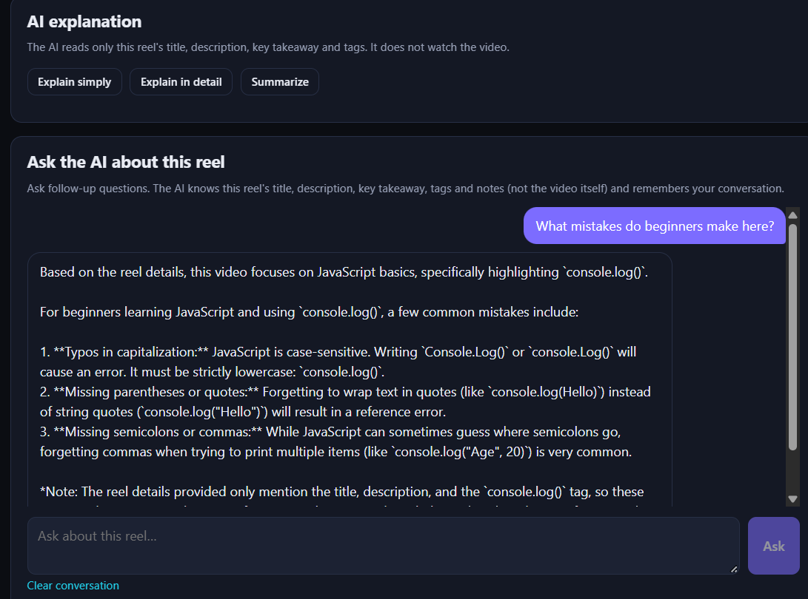
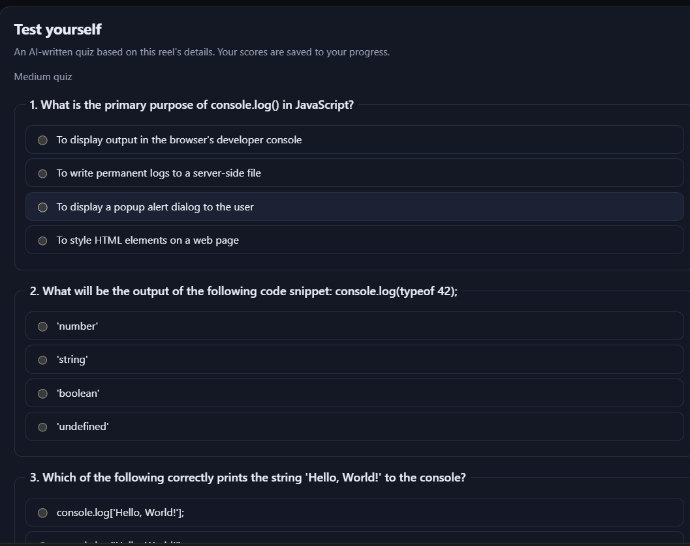
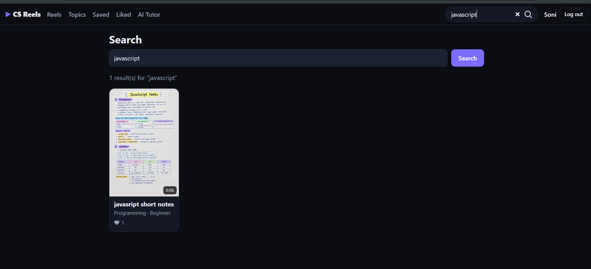
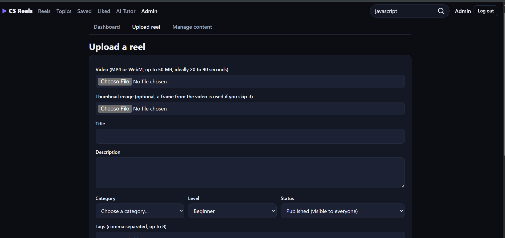
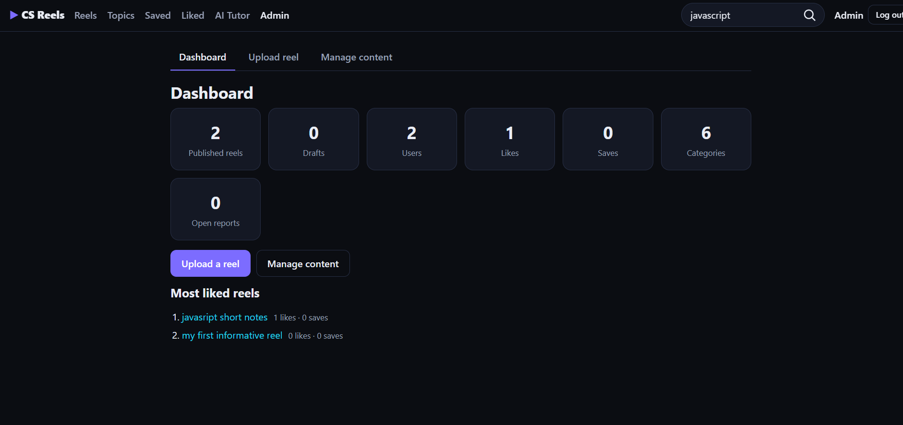
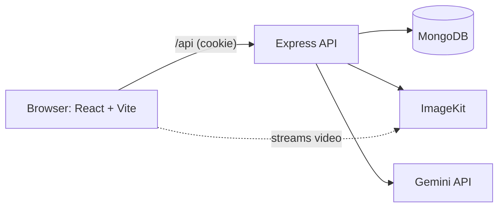

# CS Reels

**Built by Soni Singh and Sagar Chettri.**

**Short-form learning videos for computer science students.** Swipe through bite-sized videos on DSA, web development, core CS and career tips, then understand them with an AI tutor, practise with adaptive quizzes, and watch your progress grow, all in one place.

**WATCH → UNDERSTAND → PRACTICE → IMPROVE**

| | |
|---|---|
| **Demo video** | https://youtu.be/jw2-t56jVEg |
| **Source code** | https://github.com/sonisingh01/cs-reels |
| **Live link** | Not deployed. Run it locally with the [step-by-step instructions](#getting-started) below |
| **Team** | Sagar chettri and Soni singh(both worked on the frontend and the backend, roughly 50-50) |

---

## The problem
Nowadays, short-form video platforms have become a popular way for students to spend their free time. While these platforms provide quick entertainment, students often end up scrolling through videos for hours without gaining anything useful.
At the same time, traditional learning resources like lengthy tutorials and lectures can be difficult to fit into a busy student schedule.
We identified an opportunity to turn this habit into something productive: **What if students could enjoy short-form videos while learning something valuable at the same time?**

## The solution
CS Reels is a platform that makes learning easier through short-form videos. Each reel teaches one idea, sits in a topic and a difficulty level, and can link to docs, articles and practice problems. Around the videos, an AI tutor explains concepts, adaptive quizzes test understanding, and a progress dashboard shows what is working and what needs practice.

## Screenshots
| Landing | Reels feed (mobile) |
|---|---|
|  |  |
| **For you feed** | **Reel page with AI explanation** |
|  |  |
| **Ask the AI about a reel** | **Quiz** |
|  |  |
| **My progress** | **Search** |
|  |  |
| **AI tutor** | **Admin: upload a reel** |
|  |  |
| **Admin: dashboard** | |
|  | |

## Features

### Watch
- **Vertical reels feed:** one reel at a time, only the visible reel plays, swipe/scroll or arrow keys to move, play/pause, sound toggle, paginated loading, loading, empty and error states.
- **For you feed:** ranked from your own likes, saves, watched reels and quiz results. Every reel shows a plain-language reason, such as "Because you engage with #arrays" or "Strengthen Web Development: your quiz average there is 40%".
- **Topics, levels and search:** browse by topic, filter by beginner / intermediate / advanced, search by title, description, tag or topic name (partial words work).
- **Guests can browse and watch;** login is needed to like, save, report or use AI.

### Understand
- **Ask the AI about this reel:** a follow-up conversation that remembers what you asked, with examples and step-by-step explanations.
- **Explain this reel** (simple or detailed) and **summary**.
- **AI tutor chat** for general computer science questions.
- **Related resources, key takeaway and related reels** on every reel. Admins can add a **transcript or notes** that make the AI's answers more accurate.

The AI receives only a reel's **text details** (title, description, key takeaway, tags and the optional transcript/notes). It does **not** watch the video, and the interface says so.

### Practice
- **Adaptive quizzes:** 3 to 5 multiple-choice questions at Easy, Medium or Hard, validated before display.
- **Fair scoring:** correct answers stay on the server until you submit, and the score is calculated on the server.
- **Explanations, history and retries:** every attempt is saved, with attempt count and best score, and any quiz can be retaken.

### Improve
- **My progress:** reels watched and finished, quiz scores, a 7-day activity chart, learning streak, per-topic status (strong, needs practice), quiz history and recommended next reels. Only real, counted data; a new student sees an empty state, not fake numbers.
- **Likes and saves** with accurate counts and no duplicates; Saved, Liked and Profile pages.

### Platform and admin
- **Accounts:** register, login, logout; passwords hashed; session in an HTTP-only cookie.
- **Report a reel;** admins review reports.
- **Admin dashboard:** statistics, upload video (MP4/WebM) with thumbnail, edit, publish/unpublish, delete, manage topics, review reports. Admin rights are enforced on the server.

## Tech stack
| Layer | Technology |
|---|---|
| Frontend | React 19, Vite, React Router, Axios, plain CSS (dark, mobile-first) |
| Backend | Node.js, Express 5, REST API |
| Database | MongoDB with Mongoose |
| Auth and security | JWT in HTTP-only cookie, bcrypt hashing, zod validation, Helmet, CORS, rate limiting |
| Media | ImageKit (video and image storage and delivery) |
| AI | Google Gemini API (provider code isolated so it can be swapped) |
| Testing | Node test runner + Supertest (backend), Vitest + Testing Library (frontend) |

## Architecture

Request path: route, then middleware (rate limit, authentication, role check, validation), then controller, then service or model. All errors return one JSON shape. More detail, data model and design decisions: [`docs/ARCHITECTURE.md`](docs/ARCHITECTURE.md).

## Project structure
```
cs-reels/
├── backend/
│   ├── server.js
│   ├── scripts/seed.js          creates topics + admin account
│   ├── src/ config/ models/ routes/ controllers/ middleware/ validators/ services/ utils/
│   └── tests/
├── frontend/
│   └── src/ pages/ components/ layouts/ context/ hooks/ services/ utils/ test/
└── docs/                        architecture, API, testing, deployment, project guide
```

## Getting started

**You need:** Node.js 20+ (built with 24), a MongoDB database (a free [MongoDB Atlas](https://www.mongodb.com/atlas) cluster works), and optionally ImageKit and Gemini keys.

```bash
git clone https://github.com/sonisingh01/cs-reels.git
cd cs-reels

# 1. Backend
cd backend
npm install
cp .env.example .env        # Windows Command Prompt: copy .env.example .env
# edit .env (see the table below)
npm run seed                # creates the topics and your admin account
npm run dev                 # http://localhost:5000

# 2. Frontend (new terminal)
cd frontend
npm install
npm run dev                 # http://localhost:5173
```
Open http://localhost:5173 and log in with the `ADMIN_EMAIL` / `ADMIN_PASSWORD` from your `.env`. Use **Admin → Upload reel** to add content. Register a second, normal account to experience the student side (For you, quizzes, progress).

### Environment variables (`backend/.env`)
| Variable | Required | Purpose |
|---|---|---|
| `MONGODB_URI` | yes | MongoDB connection string (include a database name, e.g. `/csreels`) |
| `JWT_SECRET` | yes | 32+ random characters (`node -e "console.log(require('crypto').randomBytes(48).toString('hex'))"`) |
| `CLIENT_ORIGIN` | yes | `http://localhost:5173` for local use |
| `ADMIN_NAME`, `ADMIN_EMAIL`, `ADMIN_PASSWORD` | for seed | the admin account created by `npm run seed` |
| `IMAGEKIT_PRIVATE_KEY` | for uploads | ImageKit private key |
| `GEMINI_API_KEY`, `GEMINI_MODEL` | for AI | Gemini key and a model that is free for your project |

Without the ImageKit and Gemini keys the app still runs; uploads and AI features show a clear "not configured" message. Deployment guide: [`docs/DEPLOYMENT.md`](docs/DEPLOYMENT.md).

## Tests
```bash
cd backend && npm test      # 83 integration tests, real MongoDB, uses a separate "csreels_test" database
cd frontend && npm test     # 60 behaviour tests
```
Covered: authentication, role protection, validation, NoSQL-injection attempts, feed, search and pagination, likes and saves (including simultaneous requests), upload rules and failure cleanup, AI validation and caching, quiz integrity and scoring, recommendations, progress and streaks, data upgrades, and the main screens and flows. ImageKit and Gemini are tested against mock servers; the real services need your keys. Details: [`docs/TESTING.md`](docs/TESTING.md).

## API
Full endpoint list: [`docs/API.md`](docs/API.md).

## Security highlights
Hashed passwords; HTTP-only cookies; server-side role checks on every admin route; validation on every request; escaped search input; quiz answers withheld until submission and scored on the server; uploads checked by type, size and file signature before storage; uploaded files removed if saving fails; rate limits on login, reports, AI, quizzes, activity tracking and the API; secrets only in environment variables (`.env` is git-ignored).

## Limitations
- AI sees only reel text (including optional admin notes), not the video; there is no automatic audio transcription yet.
- A reel's video file cannot be replaced after upload (upload a new reel instead).
- AI chat history is kept only while the page is open.
- Search is not relevance-ranked; recommendations are rule-based and explainable, not machine learning.

## Roadmap
Spaced-repetition reminders for weak topics, creator profiles and playlists, automatic audio transcripts, email verification and password reset, comments.

## Acknowledgements and credits
- Built with open-source libraries: React, Vite, React Router, Axios, Express, Mongoose, zod, jsonwebtoken, bcryptjs, multer, helmet, express-rate-limit, Vitest, Supertest and others listed in the `package.json` files, each under its own license.
- Third-party services: MongoDB Atlas, ImageKit, Google Gemini API.
- We used an AI assistant (Claude by Anthropic) during development to help plan the project and to write and debug code and documentation. We ran, tested and integrated the result ourselves.

### Demo content
The reels in the demo are sample content used only to show the platform working. They are not presented as the team's own teaching work.
- One demo reel was recorded by a friend of the team.
- One demo reel is a screen recording of a video from the YouTube channel [@tech_edu.26](https://www.youtube.com/@tech_edu.26) ([original video](https://youtube.com/shorts/4suAlthPUTQ)). All rights belong to its creator. It is shown only to demonstrate the platform and will be removed on request.
