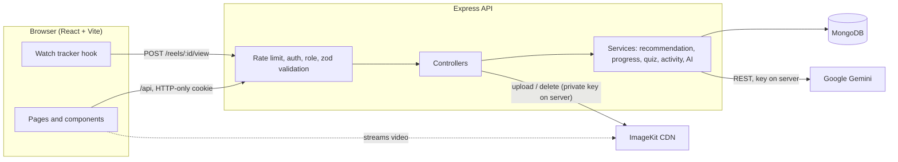
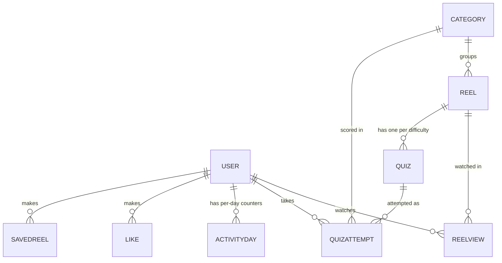
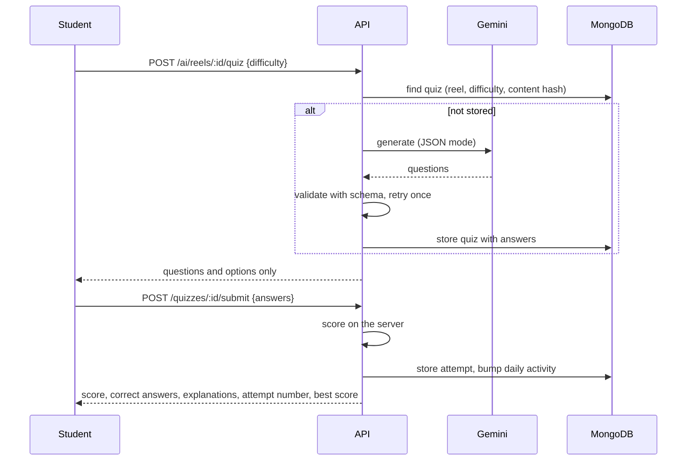

# CS Reels: Technical documentation (final round)

## 1. The product loop
CS Reels turns passive watching into learning:

| Step | What the student does | What the system does | Main endpoints |
|---|---|---|---|
| **Watch** | Scrolls the reels feed (Latest or For you) | Plays one reel at a time, records real watching (3+ seconds) | `GET /reels`, `GET /reels/recommended`, `POST /reels/:id/view` |
| **Understand** | Asks the AI about the reel, gets explanations and examples, follows up | Gemini answers using the reel's text details and the conversation so far | `POST /ai/reels/:id/explain`, `/summary`, `/chat` |
| **Practice** | Takes an Easy / Medium / Hard quiz and retries | Generates and validates questions, hides answers, scores on the server, stores every attempt | `POST /ai/reels/:id/quiz`, `POST /quizzes/:id/submit` |
| **Improve** | Opens "My progress" | Shows counted activity, weak topics and a streak, and recommends what to study next | `GET /progress`, `GET /quizzes/attempts`, `GET /reels/recommended` |

The loop closes on itself: quiz results feed the recommender, so a topic with a low quiz average is pushed back into the "For you" feed.

## 2. System architecture

Request path: route, then middleware (rate limit, authentication, role check, validation), then controller, then service or model. Every error returns the same JSON shape: `{ success: false, error: { code, message } }`.

## 3. Tech stack (unchanged from the MVP; no new dependencies were added)
| Layer | Technology |
|---|---|
| Frontend | React 19, Vite, React Router, Axios, plain CSS |
| Backend | Node.js, Express 5, zod, JWT cookies, bcryptjs, multer, helmet, express-rate-limit |
| Database | MongoDB with Mongoose |
| Media | ImageKit (REST API called from the server) |
| AI | Google Gemini `generateContent` REST API; provider code is isolated in `services/ai/providers` |
| Tests | Node test runner + Supertest (backend), Vitest + Testing Library (frontend) |

## 4. Data model

Collections added in the final round:

| Collection | Purpose | Key fields and indexes |
|---|---|---|
| **ReelView** | What each student really watched | user, reel, viewCount, maxWatchSec, completed, firstViewedAt, lastViewedAt; unique (user, reel) |
| **QuizAttempt** | Every quiz attempt (history, retry, scores) | user, quiz, reel, category, difficulty, score, total, answers[]; indexed by (user, createdAt) |
| **ActivityDay** | Daily counters for the 7-day chart and streak | user, day (the student's local YYYY-MM-DD), views, quizzes; unique (user, day) |

Changed collections: **Quiz** gains `difficulty` and is now unique per (reel, difficulty); **Reel** gains an optional `transcript` (notes the admin types).

## 5. Key design decisions

### 5.1 Honest AI grounding
The AI never "watches" the video. It receives only text: title, category, level, description, key takeaway, tags, and the optional transcript/notes an admin adds. System prompts say so explicitly and forbid claiming to have seen the video; the interface repeats it. Answers are cached by a hash of that text, so a changed reel regenerates automatically.

### 5.2 Quiz integrity
- `POST /ai/reels/:id/quiz` returns only the questions and four options. `correctIndex` and `explanation` stay on the server.
- `POST /quizzes/:id/submit` accepts only the selected option numbers, validates them (integers 0 to 3, one per question), scores them on the server, stores the attempt, and only then returns the correct answers and explanations.
- Extra fields sent by a client (a fake score, for example) are ignored; a test proves it.
- AI output is validated with a schema (3 to 5 questions, 4 distinct options, valid answer index) and retried once; invalid output is never stored.
- One stored quiz per reel and difficulty, so retries are fast and consistent; retake count and best score come from stored attempts.

### 5.3 Recommendations (explainable, not machine learning)
Signals come from the student's own data: likes, saves, watched reels and quiz attempts.

| Signal | Weight |
|---|---|
| Saved a reel | +4 for its topic and tags |
| Liked a reel | +3 |
| Watched a reel (+1 more if finished) | +1 (+1) |
| Took a quiz in a topic | +1 per attempt |
| Quiz average below 60% in a topic | +4 boost for unwatched reels in that topic ("needs practice") |
| Same level as the student usually watches | +1 (adjacent level +0.5) |
| Popularity (likes + saves) and freshness (last 14 days) | small bonus |
| Already watched | pushed to the end ("Watch again to revise") |

Every recommendation carries a plain-language reason, for example "Because you engage with #arrays" or "Strengthen Web Development: your quiz average there is 40%". A new student with no activity gets popular and new reels and is labelled as not personalised. Drafts are never recommended.

### 5.4 Progress dashboard uses only counted data
Reels watched and finished come from ReelView; quizzes and scores from QuizAttempt; saved and liked from Like and SavedReel; the 7-day chart and streak from ActivityDay. Unpublished reels are excluded. A student with no activity sees an empty-state message, not placeholder numbers. A topic's status is derived from real scores: strong at 80% or more, needs practice below 60%.

### 5.5 Time zones
The browser sends its UTC offset, so "today" and streaks follow the student's own midnight. The streak stays alive through yesterday until the student studies today.

### 5.6 Watch tracking
A frontend hook counts the time a reel is actually playing. It reports only after 3 seconds (scrolling past does not count), only for logged-in students, caps time at the reel length, and marks a reel finished at 85%. Failures are ignored so tracking can never disturb the student.

### 5.7 Safe upgrade of existing data
`runMigrations()` runs at server start and is safe to repeat: quizzes saved by the MVP become "medium" quizzes, and the old unique index (one quiz per reel) is replaced by (reel, difficulty). Nothing is deleted. A test recreates the MVP state and checks the upgrade, and the live smoke test did the same on a real server start.

## 6. Integrations
- **Google Gemini:** called only from the backend with the key in a header. Model and key come from environment variables. Timeouts, rate-limit (429) and provider errors map to friendly messages. Per-user rate limit of 30 AI requests per 10 minutes.
- **ImageKit:** videos and thumbnails are uploaded by the server with its private key after validation (type, size, file signature); uploaded files are removed if saving fails or the reel is deleted.
- **MongoDB Atlas:** all persistence through Mongoose with unique indexes protecting integrity (likes, saves, views, daily activity, quizzes).

## 7. Security summary
HTTP-only cookie sessions; hashed passwords; server-side role checks on every admin route; zod validation on every request (also blocks NoSQL operator injection); escaped search input; upload checks; rate limits on login, reports, AI, quiz submission, view tracking and the whole API; quiz answers withheld until submission and scored server-side; secrets only in environment variables.

## 8. API
Complete list with requests and responses: `docs/API.md`.

## 9. Known limitations
- AI uses text only (no audio transcription); admins can add a transcript to improve it.
- Recommendations are rule-based and tuned for a small catalogue (they rank the newest 300 published reels).
- A reel's video file cannot be replaced after upload.
- Chat history is kept while the page is open, not stored.
- Real ImageKit and Gemini calls were tested only against mock servers in automated tests.

## 10. Future scope
Spaced-repetition reminders for weak topics, creator profiles and playlists, audio transcription for automatic transcripts, email verification and password reset, learning goals and weekly summaries.
