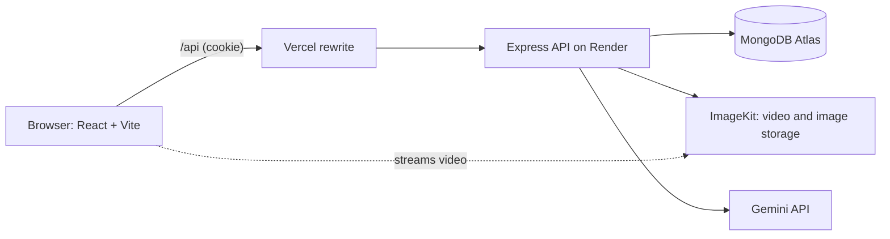
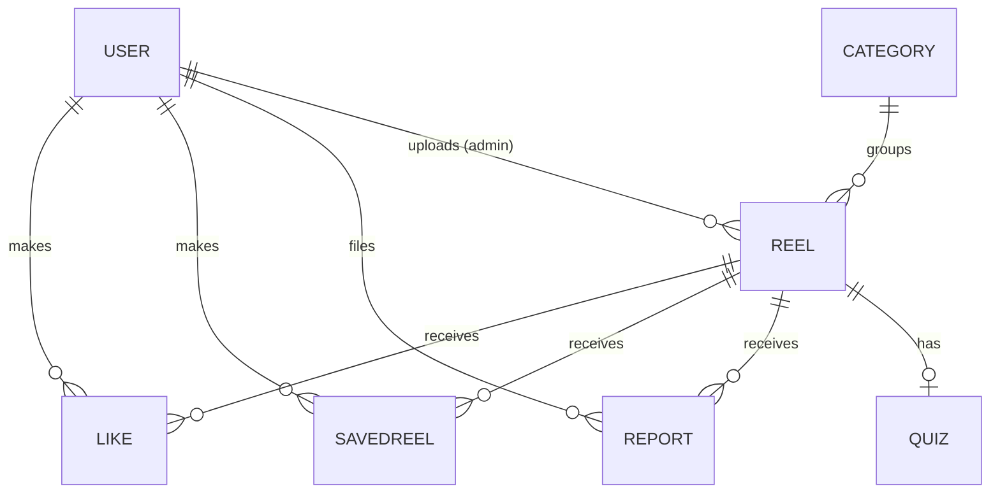

# CS Reels: Evaluation guide

Everything below describes what is actually implemented. Do not claim anything beyond it.

## Abstract
CS Reels is a web platform that teaches computer science through short vertical videos. Students scroll a one-reel-at-a-time feed, filter by topic, search, like and save reels, follow links to deeper resources, and use AI to get simpler explanations, summaries and quizzes based on a reel's text details. Admins upload and manage reels through a dashboard. It is a full-stack MERN-style application (React, Express, MongoDB) with JWT cookie authentication, role-based access control, ImageKit media storage and a Gemini-powered AI layer.

## Problem statement
Students lose study time to entertainment-first short-video apps, while long tutorials do not fit short breaks. There is no focused, organised place for bite-sized CS learning with a clear next step (resources, revision, self-testing).

## Objectives
1. Deliver CS concepts as short, focused videos in a mobile-friendly vertical feed.
2. Organise content by topic and level; allow search.
3. Let students like and save reels for revision.
4. Let an admin upload, edit, publish, unpublish and delete content safely.
5. Provide AI help (explain, summarize, quiz, tutor chat) that is honest about what it sees.
6. Keep the system secure (hashed passwords, HTTP-only cookies, server-side roles, validated input).

## Existing vs proposed system
- **Existing:** entertainment short-video apps (distracting, unstructured for learning), long video courses (time-heavy), scattered notes.
- **Proposed:** a learning-only reels feed with topics, levels, saved list, resource links and AI revision tools.

## Architecture

Request path inside the API: route, then middleware (rate limit, authenticate, role check, validate), then controller, then service/model. Errors flow to one error handler that returns the same JSON shape every time.

## Technology and why
| Tech | Why |
|---|---|
| React + Vite | component UI, fast dev build; React Router for pages |
| Express 5 | simple REST API; async errors are caught automatically |
| MongoDB + Mongoose | flexible documents (tags, resources), schemas and unique indexes for integrity |
| JWT in HTTP-only cookie | JavaScript cannot read the token (protects against XSS theft); sent automatically |
| bcryptjs | slow salted hashing of passwords |
| zod | validates and type-checks every request (also blocks NoSQL operator injection) |
| multer | reads uploaded files into memory for validation |
| ImageKit | CDN storage so the server never stores or streams videos |
| Gemini via REST | free tier, JSON mode for quizzes; provider code is isolated so it can be swapped |

## Database design

- **User:** name, email (unique), passwordHash (hidden by default), role (user/admin).
- **Category:** name, slug (both unique), description, order.
- **Reel:** title, description, videoUrl, videoFileId, thumbnailUrl, durationSec, category (ref), tags, level, keyTakeaway, resources[], creditName, uploadedBy (ref), status (draft/published/removed), likesCount, savesCount. Indexes on status, category and tags.
- **Like / SavedReel:** user + reel with a **unique compound index**, so duplicates are impossible even with simultaneous requests. The counters on Reel change only when a row is really added or removed.
- **Quiz:** one per reel, questions, contentHash (invalidates when the reel text changes).
- **Report:** reel, reporter, reason, details, status; one per user per reel.

## Use cases
- **Guest:** browse and watch the feed, search, view topics, register, log in.
- **Registered user:** everything a guest can, plus like, save, report, profile, AI explainer, quiz and tutor chat.
- **Admin:** dashboard statistics, upload, edit, publish/unpublish, delete reels, manage categories, review reports.

## Security measures implemented
Password hashing; HTTP-only, SameSite cookie (Secure in production); authentication and role middleware on the server; zod validation on every input; NoSQL injection blocked by type checking; regex input escaped in search; upload checks of type, size and file signature before anything is stored; cleanup of uploaded files if saving fails; rate limits on login, reports, AI and the API; Helmet headers; CORS limited to the frontend origin; secrets only in environment variables; generic error messages in production; same error for unknown email and wrong password.

## Limitations
No video transcription (AI uses text details only); video file cannot be replaced after upload; quiz scoring is client-side; chat history is not saved; search is not relevance-ranked; recommendations are rule-based, not machine learning; free hosting tiers sleep and have limits.

## Future scope
Streaks and progress dashboard, creator profiles and playlists, transcript-based AI, relevance-ranked search (text index), email verification and password reset, comments, notifications, analytics.

## Demo sequence (about 8 minutes)
1. Landing page, then **Start watching** as a guest: scroll reels, show one playing at a time.
2. Try to like as a guest: login prompt. Register a user.
3. Like and save; open **Saved** and **Profile**.
4. Search a tag; open a topic page; filter by level.
5. Open a reel's **Learn** page: resources, **Explain simply**, **Generate quiz**, answer and show the score.
6. **AI Tutor**: ask a question and a follow-up.
7. Log in as admin: dashboard, **Upload reel** (show validation and progress), publish it, see it appear in the feed.
8. Report a reel as a user; in admin, review the report. Show the "Admins only" page for a normal user.
9. Open the automated test results.

## Likely questions and accurate answers
**React**
- *Why React?* Reusable components, state-driven UI, large ecosystem. Pages are components; shared UI (player, actions, grids) is reused.
- *How does only one video play at a time?* Each card uses IntersectionObserver; the card that is at least 60% visible becomes "active"; only the active reel plays, its neighbours preload, the rest show only a poster image.
- *How is auth state handled?* An AuthContext asks `/auth/me` on load; route guards (`ProtectedRoute`, `AdminRoute`) redirect, but real protection is on the server.
- *What is optimistic UI?* The like count changes immediately and is rolled back if the server call fails.

**Node and Express**
- *What is middleware?* Functions that run in order on a request (rate limit, authenticate, validate); `next()` passes control; an error handler at the end formats errors.
- *Why Express 5?* It forwards errors from async handlers automatically, so no try/catch in every controller.

**MongoDB**
- *Why separate Like and SavedReel collections instead of arrays on the user?* They grow without limit; separate documents with a unique index prevent duplicates and allow paging.
- *Why store likesCount on Reel?* Fast reads without counting; kept correct by changing it only when a row is truly created or deleted.
- *How do you stop duplicate likes?* A unique index on (user, reel). Simultaneous duplicates are tested: the count stays 1.

**Authentication**
- *Why a cookie, not localStorage?* HttpOnly cookies cannot be read by JavaScript, reducing the damage of XSS.
- *How are passwords stored?* bcrypt hash with salt; the plain password is never stored or returned.
- *How are admins created?* A seed script, never public registration; the role sent at signup is ignored.
- *Why the same message for wrong email and wrong password?* To avoid revealing which emails exist.
- *CSRF?* The cookie is `SameSite=Lax` and API calls are JSON, which blocks the usual cross-site form posts. A CSRF token would be a future hardening step.

**ImageKit and uploads**
- *Upload flow?* Browser sends multipart to our API, we validate (type, size, file signature, fields), upload to ImageKit with the private key (kept on the server), then save the URL and file id in MongoDB. If saving fails, the uploaded files are deleted.
- *Why check the file signature?* The declared type can be faked; the first bytes of the file cannot.

**AI**
- *Does the AI watch the video?* No. It receives only title, category, level, description, key takeaway and tags, and the interface says so.
- *What if the AI returns bad quiz JSON?* The response is validated with a schema (3 to 5 questions, 4 options, valid correct index), retried once, then a clear error is shown; nothing invalid is stored.
- *How do you limit cost and abuse?* Per-user rate limit, caching of explanations, stored quizzes, short input limits.
- *Can the provider be changed?* Yes; provider code is isolated in `services/ai/providers`.

**Testing**
- *What did you test?* 51 backend integration tests on a real MongoDB and 32 frontend behaviour tests, plus a manual checklist. ImageKit and Gemini calls were tested against mocks; real calls are checked manually.
